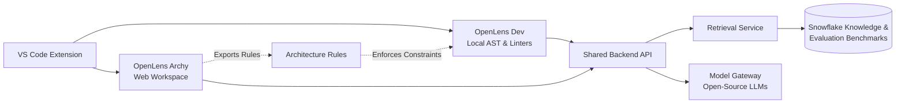

# 🔍 OpenLens

**Team:** `t1c2-logic-lords` | **Track:** Best Open-Source AI Project with Snowflake | **HackToBerFest-VVCE**

---

### *The AI Companion for Software Architecture & Code Maintainability*

OpenLens is an AI-powered engineering companion that prevents AI-generated code sprawl. It connects everyday coding in VS Code with high-level system architecture, ensuring software stays clean, modular, and maintainable as it evolves.

---

## ⚡ The Two Modes

OpenLens brings two synchronized modes into one VS Code extension:

| Mode | Where It Runs | What It Does |
| :--- | :--- | :--- |
| **🛠️ OpenLens Dev** | VS Code Editor | • Detects exact and near-duplicate code & unused symbols.<br>• Recommends existing dependencies before writing custom boilerplate.<br>• Generates minimal, reviewable diffs (**no silent changes**).<br>• Runs local checks offline via AST & standard Python linters. |
| **🏛️ OpenLens Archy** | Web Workspace | • Proposes architectures, tech stacks, and patterns from requirements.<br>• Generates Mermaid diagrams & Architecture Decision Records (ADRs).<br>• Audits brownfield repos for architecture drift & boundary violations.<br>• Produces phased, risk-aware restructuring plans. |

> **The Bridge:** Archy creates machine-checkable **Architecture Rules**, and Dev validates them inside VS Code during active development.

---

## 🏗️ Architecture Overview



---

## ❄️ Snowflake & Open-Source AI

* **Snowflake:** Serves as a curated, searchable knowledge base of validated architectural patterns and hosts versioned evaluation benchmarks. No complete source code is sent or stored by default.
* **Open-Source AI:** Uses open-weight models behind a provider-neutral gateway, with local secret redaction and configurable local/remote routing.
* **Privacy by Design:** Scoped scans, minimal payloads, and total user control over remote processing.

---

## 🛡️ Core Rules & Safety Guardrails

* **Evidence Over Hypotheses:** Tool-observed facts are clearly separated from AI inferences.
* **Developer in Full Control:** No unapproved edits, no silent changes, and no automatic dependency installations.
* **Preserve Behavior:** Refactoring prioritizes minimal, test-validated diffs.
* **Fail Safely:** Local deterministic analysis continues to work even if Snowflake or AI services are offline.

---

---

## 🏛️ OpenLens Archy — Web Workspace

The browser-based visual studio for architecture design, system flow validation, and ADR management.

### 🎨 Color Palette & Themes
Engineered with the tailored design system:
- `Dark green`: `#0A3323`
- `Moss green`: `#839958`
- `Beige`: `#F7F4D5`
- `Rosy brown`: `#D3968C`
- `Midnight green`: `#105666`

Supports **3 dynamic themes**:
1. **Dark**: Deep sleek emerald & midnight tones with high-contrast glowing flow paths.
2. **Light**: Crisp warm beige canvas with architectural blueprint grid and rich forest accents.
3. **Funk**: Neo-brutalist retro-techno theme featuring vibrant rosy brown, glowing cyber cyan, and neon moss highlights.

### ⚡ Key Features
- **Interactive System Flow Paths**: Hovering any connection path animates directional data flow particles and displays protocol metadata, source/destination telemetry, and boundary status.
- **Dynamic Layer Legend**: Clickable filters for project layers with real-time component counts (`Frontend (2)`, `Backend (19)`, `Database (3)`, `Security (1)`, `External (2)`).
- **Subsystem Boundaries**: Dashed visual domains (e.g. *Multi-Agent Advisory System*, *Air-Gapped Defense — SECRET//NOFORN*, *Dual-Stage AI Inference Pipeline*, *Advanced Sensing & Navigation*, *Data & Analytics Layer*).
- **PATH Mode**: Interactive point-to-point pipeline route tracing across boundaries.
- **LENS Drawer**: Deep component inspection with incoming/outgoing feeds and AST compliance status.
- **Multi-Format Export Dropdown**:
  - 📋 `Copy Diagram` (Direct clipboard copy)
  - 🖼️ `Save as PNG` (High-DPI retina raster export)
  - 🖼️ `Save as JPEG` (Compact image export)
  - 📐 `Save as SVG` (Infinite-resolution vector graphic)
  - 📦 `Export Rules (JSON)` (Machine-checkable AST rules for OpenLens Dev in VS Code)
  - 📝 `Export ADRs (Markdown)` (Formal Architecture Decision Records)

### 🚀 Running the Web Workspace
```bash
# Start local development server
npm start
# or open index.html directly in any modern browser
```

---

## 📚 Project Documentation

* 📄 **[PRD.md](PRD.md)** — Product Requirements Document
* 📐 **[Aritechure.md](Aritechure.md)** — Detailed System Architecture & Data Contracts
* 📋 **[phases.md](phases.md)** — 8-Phase Milestone Roadmap & Deliverables
* ⚖️ **[rules.md](rules.md)** — Behavioral, Safety, and Engineering Rules

---

**Developed with ❤️ by `t1c2-logic-lords` for HackToBerFest-VVCE.**

