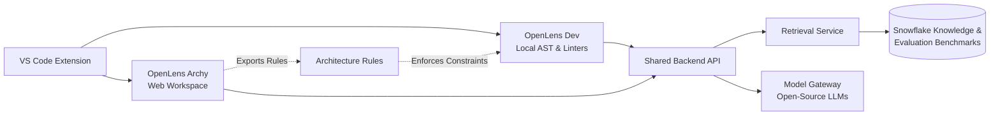

# 🔍 OpenLens

**Team:** `t1c2-logic-lords` | **Track:** Best Open-Source AI Project with Snowflake | **HackToBerFest-VVCE**

---

### *The AI Companion for Software Architecture & Code Maintainability*

OpenLens is an AI-powered engineering companion that prevents AI-generated code sprawl. It connects everyday coding in VS Code with high-level system architecture, ensuring software stays clean, modular, and maintainable as it evolves.

---

## ⚡ The Two Modes

OpenLens brings two synchronized modes into one VS Code extension:

| Mode | Where It Runs | What It Does |
| :--- | :--- | :--- |
| **🛠️ OpenLens Dev** | VS Code Editor | • Detects exact and near-duplicate code & unused symbols.<br>• Recommends existing dependencies before writing custom boilerplate.<br>• Generates minimal, reviewable diffs (**no silent changes**).<br>• Runs local checks offline via AST & standard Python linters. |
| **🏛️ OpenLens Archy** | Web Workspace | • Proposes architectures, tech stacks, and patterns from requirements.<br>• Generates Mermaid diagrams & Architecture Decision Records (ADRs).<br>• Audits brownfield repos for architecture drift & boundary violations.<br>• Produces phased, risk-aware restructuring plans. |

> **The Bridge:** Archy creates machine-checkable **Architecture Rules**, and Dev validates them inside VS Code during active development.

---

## 🏗️ Architecture Overview



---

## ❄️ Snowflake & Open-Source AI

* **Snowflake:** Serves as a curated, searchable knowledge base of validated architectural patterns and hosts versioned evaluation benchmarks. No complete source code is sent or stored by default.
* **Open-Source AI:** Uses open-weight models behind a provider-neutral gateway, with local secret redaction and configurable local/remote routing.
* **Privacy by Design:** Scoped scans, minimal payloads, and total user control over remote processing.

---

## 🛡️ Core Rules & Safety Guardrails

* **Evidence Over Hypotheses:** Tool-observed facts are clearly separated from AI inferences.
* **Developer in Full Control:** No unapproved edits, no silent changes, and no automatic dependency installations.
* **Preserve Behavior:** Refactoring prioritizes minimal, test-validated diffs.
* **Fail Safely:** Local deterministic analysis continues to work even if Snowflake or AI services are offline.

---

---

## 🏛️ OpenLens Archy — Architecture & System Design Plugin

The browser-based visual studio and plugin for user file architecture visualization, tech stack profiling, system design specification, and design pattern auditing.

### 🎨 Color Palette & Themes
Engineered with the tailored design system:
- `Dark green`: `#0A3323`
- `Moss green`: `#839958`
- `Beige`: `#F7F4D5`
- `Rosy brown`: `#D3968C`
- `Midnight green`: `#105666`

Supports **3 dynamic themes**:
1. **Dark**: Deep sleek emerald & midnight tones with high-contrast glowing flow paths.
2. **Light**: Crisp warm beige canvas with architectural blueprint grid and rich forest accents.
3. **Funk**: Neo-brutalist retro-techno theme featuring vibrant rosy brown, glowing cyber cyan, and neon moss highlights.

### ⚡ 5 Core Architectural Views
1. **📐 Architecture View**:
   - Interactive dot-grid canvas with pan and zoom (`- 100% +`, drag to pan, wheel to zoom).
   - Subsystem boundaries (*Multi-Agent Advisory System*, *Air-Gapped Defense — SECRET//NOFORN*, *Dual-Stage AI Inference Pipeline*, *Advanced Sensing & Navigation*, *Data & Analytics Layer*).
   - **Interactive Flow Paths**: Hovering any path animates directional data packets, highlights connected upstream/downstream nodes, and reveals protocol metadata.
   - **PATH Mode**: Point-to-point flow tracer discovering multi-hop routes across architecture boundaries.
   - **Layer Legend**: Clickable filters with real-time component counts (`Frontend 2`, `Backend 19`, `Database 3`, `Security 1`, `External 2`).
2. **🛠️ Tech Stack View**:
   - Vetted frameworks, libraries, and runtimes detected directly from user project files (`Streamlit` in `dashboard.py`, `FastAPI` in `api.py`, `PyTorch` in `model.py`, `ZeroMQ` in `sonar_bus.py`, `SciPy` in `preprocessing.py`, `PyCryptodome` in `security.py`, `Parquet` in `data_store.py`, `PyDeck` in `heatmap.py`).
   - Detailed versioning, category tagging, design trade-offs, and pros/cons.
3. **🏛️ System Design View**:
   - High-level architecture style specification (*Hybrid Event-Driven Pipeline & Air-Gapped Microservices*).
   - Real-time SLA performance budgets:
     - Anomaly Inference Latency: `< 15 ms`
     - ZeroMQ Bus Dispatch Latency: `< 50 µs`
     - Ingestion Throughput: `10,000 frames/sec`
     - Air-Gapped Network Egress: `0 bytes (Strict Enforced)`
   - Ingestion topology, hierarchical dual-stage inference pipeline, and zero-trust air-gap segregation.
4. **🧩 Design Patterns View**:
   - Identifies and explains design patterns implemented across user files:
     - **Strategy Pattern** (`infer.py`) — Switching between Stage 1 Autoencoder & Stage 2 Deep Features.
     - **Publisher-Subscriber** (`sonar_bus.py`) — Lock-free zero-copy acoustic bus.
     - **Pipeline & Filter** (`preprocessing.py`) — Sequential FFT and beamforming stages.
     - **Factory Method** (`agents.py`) — Dynamic advisory agent instantiation.
     - **Decorator / Middleware** (`security.py`) — Air-gapped HMAC token verification.
     - **Repository Pattern** (`data_store.py`) — Decoupled Parquet and model checkpoint storage.
   - Includes real code snippets from user files and maintainability impact metrics.
5. **📁 User Files Inventory View**:
   - Maps each physical source file to its architectural component, layer, lines of code, detected technologies, and software design patterns.

### 📥 Multi-Format Export Dropdown
- 📋 `Copy Diagram` (Direct high-res clipboard copy)
- 🖼️ `Save as PNG` (High-DPI retina raster export)
- 🖼️ `Save as JPEG` (Compact image export)
- 📐 `Save as SVG` (Infinite-resolution vector graphic)
- 📦 `Export Rules (JSON)` (Machine-checkable AST rules for OpenLens Dev in VS Code)
- 📝 `Export ADRs (Markdown)` (Formal Architecture Decision Records)

### 🚀 Running the Web Workspace
```bash
# Start local development server
npm start
# or open index.html directly in any modern browser
```

---

## 📚 Project Documentation

* 📄 **[PRD.md](PRD.md)** — Product Requirements Document
* 📐 **[Aritechure.md](Aritechure.md)** — Detailed System Architecture & Data Contracts
* 📋 **[phases.md](phases.md)** — 8-Phase Milestone Roadmap & Deliverables
* ⚖️ **[rules.md](rules.md)** — Behavioral, Safety, and Engineering Rules

---

**Developed with ❤️ by `t1c2-logic-lords` for HackToBerFest-VVCE.**

