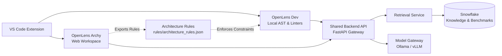

# 🔍 OpenLens

**Team:** `t1c2-logic-lords` | **Track:** Best Open-Source AI Project with Snowflake | **HackToBerFest-VVCE**

---

### *The AI Companion for Software Architecture & Code Maintainability*

OpenLens is an AI-powered engineering companion that prevents AI-generated code sprawl. It connects everyday coding in VS Code with high-level system architecture, ensuring software stays clean, modular, and maintainable as it evolves.

---

## ⚡ The Two Modes

OpenLens brings two synchronized modes into one VS Code extension:

| Mode | Where It Runs | What It Does |
| :--- | :--- | :--- |
| **🛠️ OpenLens Dev** | VS Code Editor | • Detects exact and near-duplicate code & unused symbols via Python AST.<br>• Recommends existing dependencies before writing custom boilerplate.<br>• Generates minimal, reviewable diffs (**no silent changes**).<br>• Architecture boundary enforcement via exported Archy rules. |
| **🏛️ OpenLens Archy** | Web Workspace | • Interactive architecture canvas with pan, zoom, flow path tracing.<br>• Tech stack profiling from repository files.<br>• Design pattern identification with code snippets.<br>• ADRs + exportable machine-verifiable rules for Dev enforcement. |

> **The Bridge:** Archy creates machine-checkable **Architecture Rules**, and Dev validates them inside VS Code during active development.

---

## 🚀 Running OpenLens Alongside Your Own Projects (Demo Guide)

OpenLens is designed so anyone can download this repo from GitHub and immediately run it alongside their own codebases.

### Option 1: Live In-IDE Squigglies in VS Code (Recommended for Demo)
OpenLens highlights code issues directly inside your VS Code editor with red, orange, and yellow squiggly lines:

1. **1-Click Install to VS Code:**
   ```bash
   python openlens.py install-extension
   ```
   *Or:* Open this `OpenLens_Project` in VS Code and press **`F5`** (launches Extension Development Host).
2. **Open your other project in VS Code:**
   - In VS Code, open the folder of the project you want to demo.
   - Open any `.py` file: OpenLens highlights complexity spikes, duplicate functions, unused imports, and architectural boundary drift directly on the code!
   - Hover over any squiggly line to view the diagnostic, rationale, and Snowflake pattern.
   - Press `Ctrl+.` (`Cmd+.`) to use **Quick Fix** (e.g. 1-click delete unused imports).
   - Check the **OpenLens status bar item** (`$(search) OpenLens: X issues`) in the bottom right.
   - Click the **OpenLens icon** in the left Activity Bar to browse the full findings tree.

---

### Option 2: Run via CLI Watcher / Scanner
Scan or continuously watch your other project from the terminal:
```bash
# Scan any project folder
python openlens.py scan /path/to/your/other/project

# Live watch mode (re-scans on file save)
python openlens.py watch /path/to/your/other/project

# Output in JSON or standard IDE SARIF format
python openlens.py scan /path/to/your/other/project --sarif
```

---

### Option 3: Web Workspaces (Archy & Dev Studio)
```bash
npm start
# or: python openlens.py serve
# → http://localhost:3000 — Landing page
# → http://localhost:3000/openlens-archy/ — Archy visual architecture studio
# → http://localhost:3000/openlens-dev/ — Dev maintainability explorer with In-IDE code highlights
```

---

## 🏗️ Architecture Overview



---

## ❄️ Snowflake Core Intelligence Layer (Required)

Snowflake serves as the **central knowledge repository, machine-checkable ADR rules store, and evaluation intelligence lake** for OpenLens. Every deployment connects to Snowflake to power pattern retrieval and telemetry.

| Schema | Tables | Purpose |
|:---|:---|:---|
| `KNOWLEDGE` | `ARCHITECTURAL_PATTERNS`, `LIBRARY_KNOWLEDGE`, `REFACTORING_CASES` | Curated pattern retrieval via Cortex vector search |
| `EVALUATION` | `BENCHMARK_CASES`, `EVALUATION_RUNS`, `CASE_RESULTS`, `RETRIEVAL_QUALITY` | Versioned detector benchmarks & reproducible evaluation |
| `ANALYTICS` | `FINDING_FEEDBACK`, `SCAN_METRICS`, `ARCHY_SESSION_METRICS` | Privacy-safe aggregate product quality metrics |
| `RULES` | `ARCHITECTURE_RULES`, `ARCHITECTURE_DECISIONS`, `RULE_VIOLATION_LOG` | Machine-verifiable rules authored in Archy |

**Privacy guarantees:**
- ❌ No raw source code stored in Snowflake
- ❌ No secrets or credentials transmitted
- ✅ File paths hashed (SHA-256) before logging
- ✅ Session IDs anonymised
- ✅ Aggregate metrics only for analytics

### 🚀 Activating Snowflake in OpenLens

When you open OpenLens (Dev Studio or Archy Studio), an **interactive Snowflake Activation Window** opens automatically, prompting you to:
1. **Sign In with an Existing Snowflake Account** (Account locator, user, password / key-pair, warehouse, role)
2. **Create a Free Snowflake Account** (30-day Free Trial with $400 in cloud credits, opens sign-up in a new window)

#### Connecting via Terminal (CLI Onboarding)
```bash
# 1. Interactive sign-in or launch sign-up in browser:
py openlens.py snowflake-login

# 2. Check connection health:
py openlens.py snowflake-status

# 3. Deploy schemas & seed tables to your Snowflake account:
snowsql -f snowflake/schema.sql
```

#### Connecting via Web Studios
```bash
# Start backend API (port 8000)
py openlens.py serve-api

# Start Web Studio (port 3000)
py openlens.py serve
```
Open **Dev Studio** (`http://localhost:3000/openlens-dev/`) or **Archy Studio** (`http://localhost:3000/openlens-archy/`). The Snowflake Activation Window prompts you immediately to authenticate or create your trial account. Once connected, your workspace is fully unlocked.

---

## 🛠️ Project Structure

```
OpenLens_Project/
├── index.html                    # Landing page
├── openlens-archy/               # Archy web workspace (browser)
│   ├── index.html                # Main workspace UI
│   ├── app.js                    # Rendering, pan/zoom, interactions
│   ├── data.js                   # Architecture presets & datasets
│   ├── export.js                 # PNG/SVG/JSON/Markdown exporter
│   └── styles.css                # 3-theme design system
├── engine/
│   └── ast_scanner.py            # Python AST analysis engine
├── api/
│   └── gateway.py                # FastAPI shared backend gateway
├── services/
│   ├── snowflake_bridge.py       # Snowflake knowledge retrieval
│   ├── retrieval.py              # Pattern & case retrieval service
│   └── model_adapter.py         # Provider-neutral model gateway
├── snowflake/
│   └── schema.sql                # Full Snowflake DB schema + seed data
├── rules/
│   └── architecture_rules.json  # Exportable architecture rules (Archy → Dev)
├── requirements.txt              # Python dependencies
├── package.json                  # Node scripts
├── PRD.md                        # Product Requirements Document
├── Aritechure.md                 # System Architecture
├── phases.md                     # 8-Phase Roadmap
└── rules.md                      # Behavioral & Engineering Rules
```

---

## 🏛️ OpenLens Archy — Feature Showcase

### 🎨 3 Dynamic Themes
- **Classic** — Blueprint slate: indigo-blue accents on crisp white canvas
- **Funk** — Coral rose: vivid coral-red + amber on warm cream
- **Signal Flow** — Emerald circuit: emerald + cyan on mint-white

### ⚡ 5 Architecture Views
1. **📐 Architecture Canvas** — Interactive pan/zoom canvas with subsystem boundaries, flow path animations, PATH tracer, LENS inspector, and layer legend
2. **🛠️ Tech Stack Profile** — Vetted frameworks detected from repository files with versioning, pros/cons, and rationale
3. **🏛️ System Design** — Architecture style, SLA budgets, and topology specifications
4. **🧩 Design Patterns** — Identified patterns with code snippets and maintainability impact
5. **📁 User Files Inventory** — Evidence-based mapping of source files to architecture layers

### 📥 Multi-Format Export
- 📋 Copy Diagram to clipboard (high-res PNG)
- 🖼️ Save as PNG / JPEG (Retina 2× DPI)
- 📐 Save as SVG (infinite resolution vector)
- 📦 Export Architecture Rules (JSON for Dev)
- 📝 Export ADRs (Markdown)

---

## 🔒 Safety Guardrails

| Principle | Implementation |
|:---|:---|
| No unapproved code changes | Every patch requires explicit diff review and approval |
| No silent dependency installs | Library recommendations only; never auto-install |
| Secret redaction | Regex scanning removes API keys, tokens before remote calls |
| Fail-safe offline | Local AST checks run when Snowflake & AI are both offline |
| Minimal payloads | Only sanitised metadata leaves the local machine |
| Model output = proposal | LLM output never directly executes or modifies files |

---

## 🧠 Open-Source AI

OpenLens uses a **provider-neutral ModelGatewayAdapter** interface:

```python
class ModelGatewayAdapter(ABC):
    async def complete(self, prompt: BoundedPrompt) -> ModelProposal: ...
```

Supported adapters:
- **Ollama** (local) — `OPENLENS_MODEL_PROVIDER=ollama`
- **vLLM** (local) — extend `ModelGatewayAdapter`
- **Stub** — transparent fallback when no model is configured

All adapters apply `redact_secrets()` before transmitting. Configure via:
```bash
OPENLENS_MODEL_PROVIDER=ollama
OLLAMA_BASE_URL=http://localhost:11434
OPENLENS_LOCAL_MODEL=llama3
OPENLENS_ALLOW_REMOTE=false   # remote requires explicit consent
```

---

## 📚 Project Documentation

* 📄 **[PRD.md](PRD.md)** — Product Requirements Document (v0.1)
* 📐 **[Aritechure.md](Aritechure.md)** — System Architecture & Data Contracts
* 📋 **[phases.md](phases.md)** — 8-Phase Milestone Roadmap
* ⚖️ **[rules.md](rules.md)** — Behavioral, Safety & Engineering Rules
* ❄️ **[snowflake/schema.sql](snowflake/schema.sql)** — Full Snowflake DB Schema

---

## 📊 Evaluation Metrics

OpenLens tracks measurable quality via Snowflake:

**Dev metrics:** Duplicate detection precision/recall · False-positive rate · Patch test outcome rate · Library recommendation applicability

**Archy metrics:** ADR coverage of requirements · Rule traceability to decisions · Architecture drift detection rate

**Product metrics:** Time to first finding · Finding acceptance/dismissal rate · Scan duration · Privacy incidents (target: 0)

---

**Developed with ❤️ by `t1c2-logic-lords` for HackToBerFest-VVCE.**
